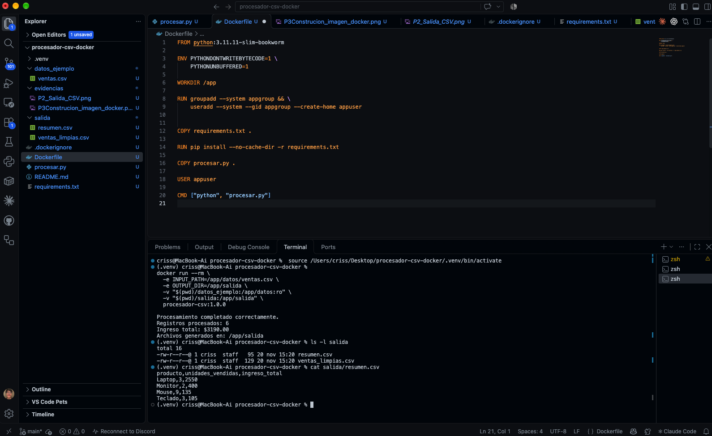
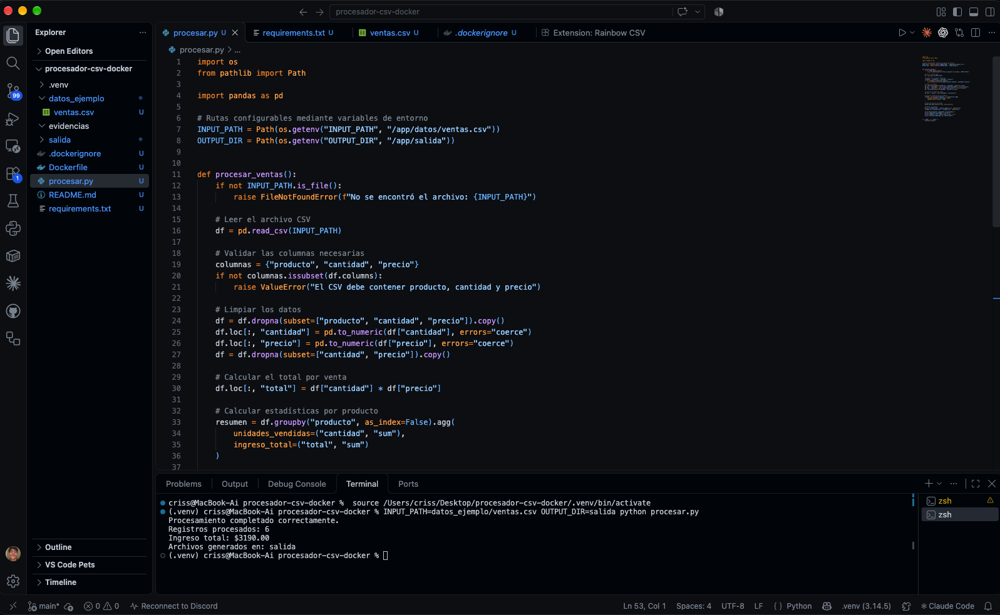
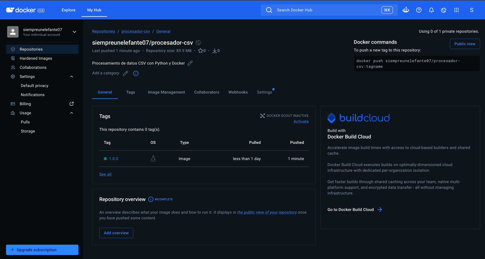
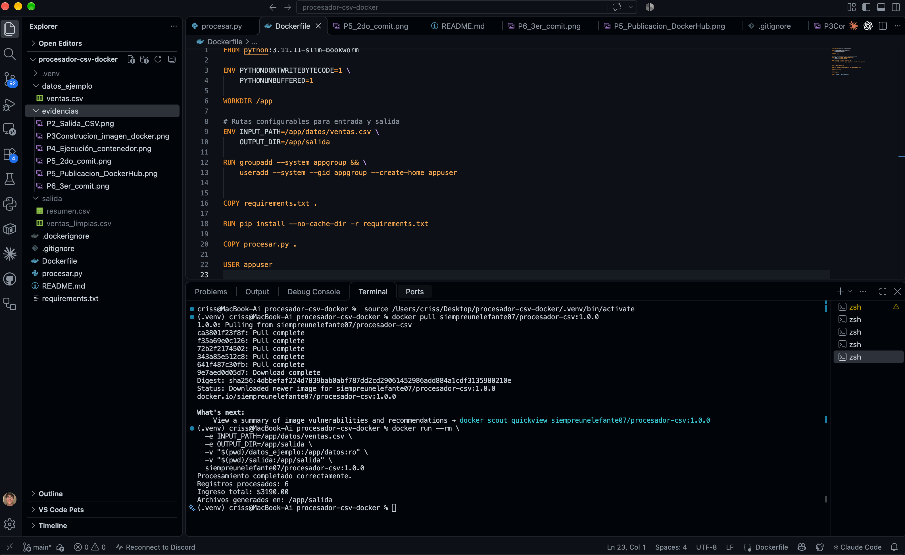

# Procesador de Datos CSV con Docker

## 1. Descripción del proyecto

Este proyecto consiste en desarrollar una aplicación de procesamiento de datos utilizando Python y pandas, empaquetada dentro de un contenedor Docker.

El programa permite leer un archivo CSV que contiene información de ventas, limpiar los datos, calcular el total de cada venta y generar un resumen de ingresos por producto.

El objetivo principal es demostrar la portabilidad de una aplicación mediante Docker, aplicando buenas prácticas como el uso de imágenes ligeras, versiones fijas, caché de capas, usuarios sin privilegios y configuración mediante variables de entorno.

Este proyecto fue desarrollado como parte de la asignatura **Infraestructura y Servicios Cloud para Procesamiento de Datos** de la Universidad de Guayaquil.

## 2. Tecnologías utilizadas

- **Python 3.11:** lenguaje utilizado para desarrollar el script.
- **pandas 2.2.3:** biblioteca para limpiar y procesar datos.
- **Docker:** herramienta para construir y ejecutar contenedores.
- **Docker Hub:** plataforma donde se publica la imagen.
- **Git:** sistema de control de versiones.
- **GitHub:** repositorio para almacenar el código y la documentación.

## 3. Estructura del proyecto

```text
procesador-csv-docker/
│
├── procesar.py
├── requirements.txt
├── Dockerfile
├── .dockerignore
├── .gitignore
├── README.md
│
├── datos_ejemplo/
│   └── ventas.csv
│
└── evidencias/
    ├── P2_Salida_CSV.png
    ├── P3Construccion_imagen_docker.png
    ├── P4_Ejecución_contenedor.png
    ├── P4.1_Segundo_commit.png
    ├── P4.2_Tercer_commit.png
    ├── P5_Publicacion_DockerHub.png
    └── P6_Prueba_portabilidad.png
```

### Descripción de los archivos

| Archivo | Función |
|---|---|
| `procesar.py` | Script principal para procesar los datos CSV. |
| `requirements.txt` | Dependencias de Python con versiones fijas. |
| `Dockerfile` | Instrucciones para construir la imagen Docker. |
| `.dockerignore` | Excluye archivos innecesarios durante la construcción. |
| `.gitignore` | Evita subir archivos temporales o sensibles a GitHub. |
| `README.md` | Documentación para reproducir el proyecto. |
| `datos_ejemplo/ventas.csv` | Archivo CSV utilizado como entrada. |
| `evidencias/` | Capturas de las pruebas y resultados. |

## 4. Requisitos previos

Para ejecutar el proyecto se necesita:

- Docker instalado y funcionando.
- Acceso a una terminal.
- Conexión a Internet para descargar la imagen desde Docker Hub.

No es necesario instalar Python ni pandas en la computadora, ya que ambas dependencias están incluidas dentro de la imagen Docker.

## 5. Funcionamiento del programa

El procesamiento se realiza de la siguiente manera:

1. Se lee el archivo `ventas.csv`.
2. Se comprueba que existan las columnas necesarias.
3. Se eliminan los registros con datos incompletos o valores numéricos inválidos.
4. Se calcula el total de cada venta multiplicando cantidad por precio.
5. Se agrupan los registros por producto.
6. Se calcula la cantidad total vendida y los ingresos de cada producto.
7. Se generan los archivos `ventas_limpias.csv` y `resumen.csv`.

### Archivo de entrada

El archivo `ventas.csv` contiene:

```csv
producto,cantidad,precio
Laptop,2,850
Mouse,5,15
Teclado,3,35
Monitor,2,200
Mouse,4,15
Laptop,1,850
```

## 6. Construcción de la imagen Docker

Para construir la imagen localmente, abrir una terminal en la carpeta principal del proyecto y ejecutar:

```bash
docker build -t procesador-csv:1.0.0 .
```

Este comando construye una imagen Docker utilizando el archivo `Dockerfile`.

Para verificar que la imagen fue creada:

```bash
docker images
```

La imagen debe aparecer con el nombre `procesador-csv` y la versión `1.0.0`.

### Evidencia de construcción


## 7. Ejecución del contenedor

Primero, crear la carpeta donde se almacenarán los resultados:

```bash
mkdir -p salida
```

Después, ejecutar el contenedor:

```bash
docker run --rm \
  -e INPUT_PATH=/app/datos/ventas.csv \
  -e OUTPUT_DIR=/app/salida \
  -v "$(pwd)/datos_ejemplo:/app/datos:ro" \
  -v "$(pwd)/salida:/app/salida" \
  procesador-csv:1.0.0
```

Este comando utiliza variables de entorno para configurar las rutas y volúmenes para compartir archivos entre la computadora y el contenedor.

La opción `--rm` elimina automáticamente el contenedor cuando termina su ejecución.

### Evidencia de ejecución



## 8. Configuración mediante variables de entorno

La aplicación permite modificar las rutas de entrada y salida sin cambiar el código Python.

| Variable | Descripción | Valor predeterminado |
|---|---|---|
| `INPUT_PATH` | Ruta del archivo CSV de entrada. | `/app/datos/ventas.csv` |
| `OUTPUT_DIR` | Carpeta donde se guardan los resultados. | `/app/salida` |

Las variables se configuran mediante la opción `-e` del comando `docker run`.

Esto permite ejecutar la misma imagen en diferentes entornos.

## 9. Configuración de volúmenes

Se utilizan montajes de directorios para compartir información entre la computadora y el contenedor.

| Carpeta local | Ruta del contenedor | Función |
|---|---|---|
| `datos_ejemplo/` | `/app/datos` | Archivo de entrada, solo lectura. |
| `salida/` | `/app/salida` | Almacenamiento de los resultados. |

El volumen de entrada utiliza `:ro` para impedir que el contenedor modifique los archivos originales.

El volumen de salida permite conservar los archivos generados incluso después de eliminar el contenedor.

## 10. Resultados esperados

Al ejecutar correctamente el programa, la terminal muestra:

```text
Procesamiento completado correctamente.
Registros procesados: 6
Ingreso total: $3190.00
Archivos generados en: /app/salida
```

Se generan dos archivos:

- `ventas_limpias.csv`: contiene los registros procesados y el total de cada venta.
- `resumen.csv`: contiene las unidades vendidas y los ingresos por producto.

### Contenido esperado de resumen.csv

```csv
producto,unidades_vendidas,ingreso_total
Laptop,3,2550
Monitor,2,400
Mouse,9,135
Teclado,3,105
```

### Evidencia de resultados



## 11. Buenas prácticas implementadas

El proyecto aplica las siguientes buenas prácticas de Docker:

### Imagen base ligera y versionada

Se utiliza la imagen:

```dockerfile
FROM python:3.11.11-slim-bookworm
```

Esto permite trabajar con una versión específica de Python y una distribución ligera.

### Optimización de caché de capas

Las dependencias se copian e instalan antes del código principal:

```dockerfile
COPY requirements.txt .
RUN pip install --no-cache-dir -r requirements.txt

COPY procesar.py .
```

De esta manera, Docker puede reutilizar la capa de dependencias cuando únicamente cambia el código Python.

### Usuario sin privilegios

La aplicación se ejecuta utilizando un usuario llamado `appuser`, evitando trabajar como root.

```dockerfile
USER appuser
```

### Comando CMD en formato exec

Se utiliza:

```dockerfile
CMD ["python", "procesar.py"]
```

### Exclusión de archivos innecesarios

El archivo `.dockerignore` evita incluir entornos virtuales, archivos temporales, datos locales y otros archivos que no son necesarios dentro de la imagen.

### Configuración externa

Las rutas se configuran mediante variables de entorno y volúmenes, sin necesidad de modificar el código fuente.

### Dependencias versionadas

El archivo `requirements.txt` contiene:

```text
pandas==2.2.3
```

Esto permite instalar una versión específica de la biblioteca utilizada.

## 12. Puertos

Este proyecto no necesita exponer puertos porque funciona como una aplicación de procesamiento de archivos CSV.

No utiliza un servidor web ni requiere conexiones HTTP.

## 13. Publicación en Docker Hub

La imagen Docker fue publicada en Docker Hub utilizando una etiqueta de versión específica.

**Repositorio:**

[siempreunelefante07/procesador-csv](https://hub.docker.com/r/siempreunelefante07/procesador-csv)

**Imagen:**

```text
siempreunelefante07/procesador-csv:1.0.0
```

**Versión publicada:** `1.0.0`

### Comando para descargar la imagen

```bash
docker pull siempreunelefante07/procesador-csv:1.0.0
```

### Evidencia de publicación



## 14. Prueba de portabilidad

Para comprobar que la aplicación puede ejecutarse sin construir la imagen localmente, se realizó una prueba descargando la imagen publicada en Docker Hub.

### Paso 1. Eliminar las imágenes locales

```bash
docker rmi siempreunelefante07/procesador-csv:1.0.0
docker rmi procesador-csv:1.0.0
```

### Paso 2. Descargar la imagen publicada

```bash
docker pull siempreunelefante07/procesador-csv:1.0.0
```

### Paso 3. Crear la carpeta de salida

```bash
mkdir -p salida
```

### Paso 4. Ejecutar el contenedor descargado

```bash
docker run --rm \
  -e INPUT_PATH=/app/datos/ventas.csv \
  -e OUTPUT_DIR=/app/salida \
  -v "$(pwd)/datos_ejemplo:/app/datos:ro" \
  -v "$(pwd)/salida:/app/salida" \
  siempreunelefante07/procesador-csv:1.0.0
```

### Resultado de la prueba

```text
Procesamiento completado correctamente.
Registros procesados: 6
Ingreso total: $3190.00
Archivos generados en: /app/salida
```

La prueba fue exitosa, demostrando que la aplicación puede ejecutarse utilizando directamente la imagen publicada en Docker Hub.

### Evidencia de portabilidad



## 15. Control de versiones con Git y GitHub

El proyecto utiliza Git para registrar los cambios realizados durante el desarrollo.

Se realizaron commits para documentar la implementación del procesamiento CSV, la configuración de Docker y la documentación del proyecto.

### Evidencias del historial de commits

**Segundo commit:**


**Tercer commit:**


### Repositorio de GitHub

[Procesador CSV Docker - GitHub](https://github.com/PaulDelgado07/Procesador_csv_docker)

## 16. Conclusión

Mediante esta actividad pude aprender a empaquetar un programa de Python dentro de una imagen Docker y ejecutarlo utilizando variables de entorno y volúmenes.

También aprendí a aplicar buenas prácticas al crear el Dockerfile, publicar una imagen en Docker Hub y documentar el proyecto en GitHub.

Finalmente, comprobé que la aplicación funciona al descargar la imagen desde Docker Hub, demostrando que puede ejecutarse sin instalar Python ni sus dependencias directamente en la computadora.

## 17. Autor

Proyecto académico desarrollado para la asignatura **Infraestructura y Servicios Cloud para Procesamiento de Datos**.

**Universidad de Guayaquil**  
**Facultad de Ciencias Matemáticas y Físicas**  
**Carrera: Ciencias de Datos e Inteligencia Artificial**
