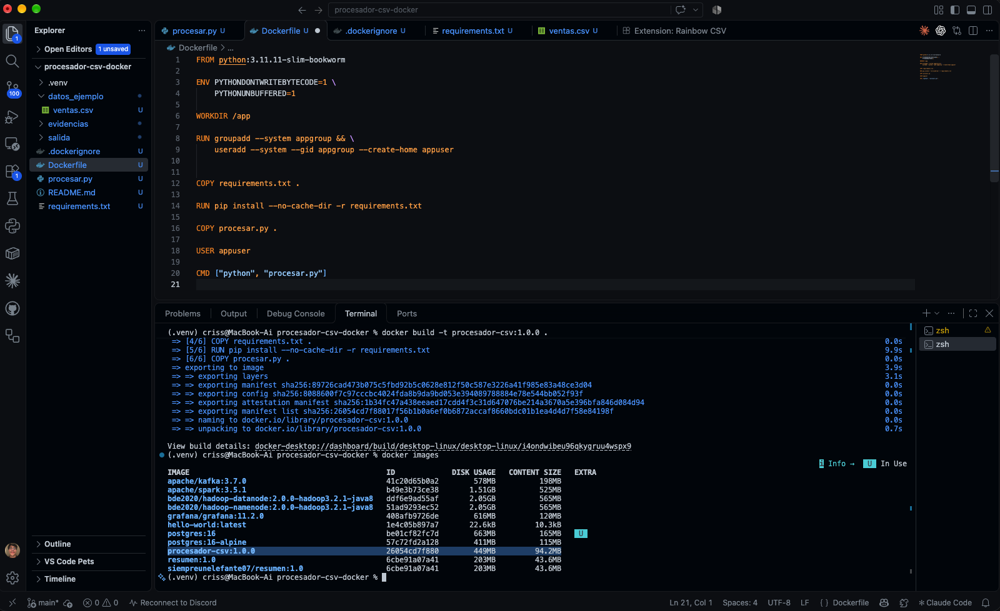
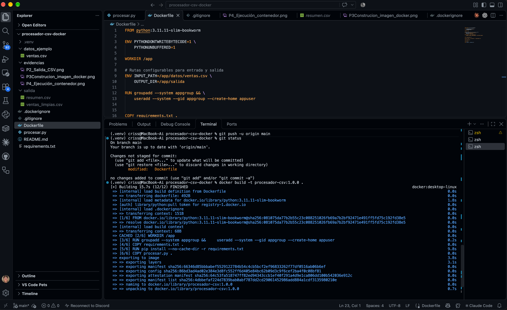
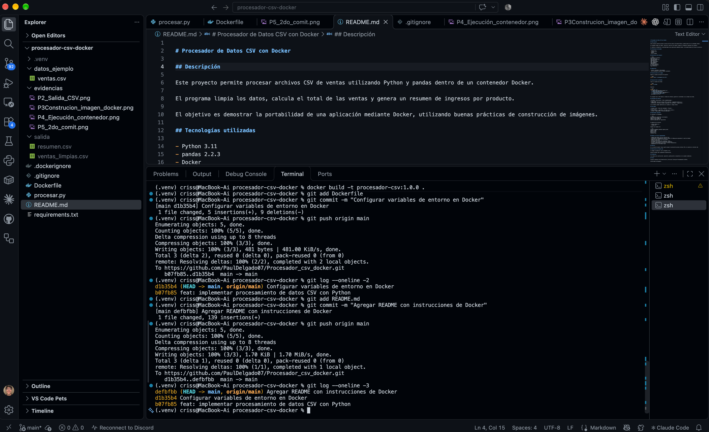

# Procesador de datos CSV con Docker

Aplicación académica desarrollada en Python que lee un archivo CSV de ventas, limpia los datos, calcula el importe de cada operación y genera un resumen de ingresos por producto. La aplicación se ejecuta dentro de una imagen Docker y permite compartir datos con el contenedor mediante variables de entorno y volúmenes.

Proyecto realizado para la asignatura **Infraestructura y Servicios Cloud para Procesamiento de Datos**, Universidad de Guayaquil.

## Tecnologías utilizadas

- Python 3.11
- pandas 2.2.3
- Docker
- Docker Hub
- Git y GitHub

## Estructura del proyecto

```text
procesador-csv-docker/
├── datos_ejemplo/
│   └── ventas.csv
├── evidencias/
│   ├── P2_Salida_CSV.png
│   ├── P3_Construcion_imagen_docker.png
│   ├── P4_Ejecución_contenedor.png
│   ├── P4.1_Segundo_commit.png
│   ├── P4.2_Tercer_commit.png
│   ├── P5_Publicacion_DockerHub.png
│   └── P6_Prueba_portabilidad.png
├── salida/
│   ├── resumen.csv
│   └── ventas_limpias.csv
├── .dockerignore
├── .gitignore
├── Dockerfile
├── procesar.py
├── README.md
└── requirements.txt
```

| Archivo | Descripción |
|---|---|
| `procesar.py` | Lee y valida el CSV, limpia los datos y genera los resultados. |
| `Dockerfile` | Construye la imagen de Python 3.11 con el usuario sin privilegios `appuser`. |
| `requirements.txt` | Declara la dependencia fija `pandas==2.2.3`. |
| `datos_ejemplo/ventas.csv` | Archivo CSV utilizado como entrada. |
| `salida/` | Archivos generados por la aplicación. |
| `evidencias/` | Capturas utilizadas como evidencia de las pruebas realizadas. |

## Requisitos previos

- Docker Desktop instalado y en ejecución.
- Terminal o PowerShell.
- Conexión a Internet para descargar la imagen o publicar en Docker Hub.

No es necesario instalar Python ni pandas en el equipo cuando se usa la imagen Docker.

## Datos de entrada

El archivo `datos_ejemplo/ventas.csv` tiene el siguiente contenido:

```csv
producto,cantidad,precio
Laptop,2,850
Mouse,5,15
Teclado,3,35
Monitor,2,200
Mouse,4,15
Laptop,1,850
```

## Funcionamiento

El programa realiza estas operaciones:

1. Lee el archivo indicado por `INPUT_PATH`.
2. Comprueba que existan las columnas `producto`, `cantidad` y `precio`.
3. Elimina filas incompletas o con valores numéricos inválidos.
4. Calcula el importe de cada venta como `cantidad * precio`.
5. Agrupa los registros por producto.
6. Guarda `ventas_limpias.csv` y `resumen.csv` en `OUTPUT_DIR`.

La salida esperada se encuentra en [`resumen.csv`](salida/resumen.csv):

```csv
producto,unidades_vendidas,ingreso_total
Laptop,3,2550
Monitor,2,400
Mouse,9,135
Teclado,3,105
```

La ejecución también debe mostrar:

```text
Procesamiento completado correctamente.
Registros procesados: 6
Ingreso total: $3190.00
```

## Construcción de la imagen

Desde la carpeta raíz del proyecto, ejecutar:

```bash
docker build -t procesador-csv:1.0.0 .
```

Comprobar que la imagen fue creada:

```bash
docker images
```

### Evidencia de construcción



## Ejecución con Docker

### macOS o Linux

```bash
mkdir -p salida

docker run --rm \
  -e INPUT_PATH=/app/datos/ventas.csv \
  -e OUTPUT_DIR=/app/salida \
  -v "$(pwd)/datos_ejemplo:/app/datos:ro" \
  -v "$(pwd)/salida:/app/salida" \
  procesador-csv:1.0.0
```

### Windows PowerShell

```powershell
New-Item -ItemType Directory -Force salida | Out-Null

docker run --rm `
  -e INPUT_PATH=/app/datos/ventas.csv `
  -e OUTPUT_DIR=/app/salida `
  -v "${PWD}/datos_ejemplo:/app/datos:ro" `
  -v "${PWD}/salida:/app/salida" `
  procesador-csv:1.0.0
```

Al finalizar, revisar los archivos generados:

```bash
ls -l salida
cat salida/resumen.csv
```

### Evidencia de ejecución


### Evidencia de los resultados


## Variables de entorno y volúmenes

| Variable | Valor dentro del contenedor | Descripción |
|---|---|---|
| `INPUT_PATH` | `/app/datos/ventas.csv` | Ruta del archivo CSV de entrada. |
| `OUTPUT_DIR` | `/app/salida` | Carpeta donde se generan los resultados. |

| Origen local | Destino en el contenedor | Permisos |
|---|---|---|
| `datos_ejemplo/` | `/app/datos` | Solo lectura mediante `:ro`. |
| `salida/` | `/app/salida` | Lectura y escritura. |

## Buenas prácticas implementadas

### Imagen base ligera y fija

El proyecto utiliza `python:3.11.11-slim-bookworm`, que reduce el tamaño de la imagen y fija una versión específica de Python.

### Optimización de caché

Primero se copian e instalan las dependencias y después el código fuente. De esta manera, Docker reutiliza la capa de pandas cuando solo cambia `procesar.py`.

### Usuario sin privilegios

La aplicación usa el usuario `appuser` en lugar de ejecutar todo como `root`.

### Configuración externa

Las rutas de entrada y salida se reciben mediante variables de entorno y no están codificadas dentro del contenedor.

### Dependencias reproducibles

Las dependencias están fijadas en `requirements.txt`:

```text
pandas==2.2.3
```

### Archivos excluidos

El archivo `.dockerignore` excluye entornos virtuales, cachés de Python, variables de entorno y carpetas locales innecesarias para construir la imagen.

## Publicación en Docker Hub

La imagen publicada es:

[siempreunelefante07/procesador-csv:1.0.0](https://hub.docker.com/r/siempreunelefante07/procesador-csv)

Comandos utilizados para iniciar sesión y publicar:

```bash
docker login
docker tag procesador-csv:1.0.0 siempreunelefante07/procesador-csv:1.0.0
docker push siempreunelefante07/procesador-csv:1.0.0
```

### Evidencia de publicación


## Prueba de portabilidad

Esta prueba permite comprobar que la imagen puede ejecutarse en otro equipo sin crearla localmente.

1. Descargar la imagen publicada:

```bash
docker pull siempreunelefante07/procesador-csv:1.0.0
```

2. Crear la carpeta de salida:

```bash
mkdir -p salida
```

3. Ejecutar la imagen descargada:

```bash
docker run --rm \
  -e INPUT_PATH=/app/datos/ventas.csv \
  -e OUTPUT_DIR=/app/salida \
  -v "$(pwd)/datos_ejemplo:/app/datos:ro" \
  -v "$(pwd)/salida:/app/salida" \
  siempreunelefante07/procesador-csv:1.0.0
```

La prueba fue exitosa y produjo los mismos seis registros procesados y el ingreso total de `$3190.00`, demostrando que la aplicación puede ejecutarse sin reconstruir la imagen.

### Evidencia de portabilidad


## Control de versiones

El proyecto se gestiona con Git y se publica en GitHub:

[Repositorio en GitHub](https://github.com/PaulDelgado07/Procesador_csv_docker)

### Segundo commit



### Tercer commit



## Conclusión

El proyecto demuestra cómo empaquetar una aplicación de Python y pandas en Docker. El uso de variables de entorno, volúmenes y una imagen publicada permite reproducir el procesamiento en diferentes equipos sin instalar las dependencias Python directamente en el sistema operativo.

## Autor

Proyecto académico desarrollado para la carrera **Ciencias de Datos e Inteligencia Artificial**, Universidad de Guayaquil.
